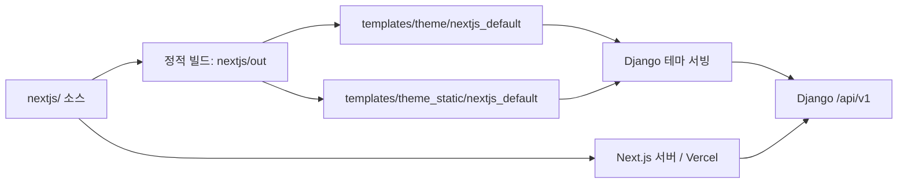

# Next.js Default 테마 구현 플랜

> **Summary**: `nextjs/` 소스를 기준으로 그누보드5 참고 테마를 Django의 `nextjs_default` 테마로 이식한다.
>
> **Project**: GNU Jango
> **Version**: 1.0
> **Author**: Codex
> **Created**: 2026-10-07
> **Status**: 기반 실행·연동·로컬 설치/복구 확인 완료 — 쇼핑몰·게시판 서브페이지 디자인 개선은 미완료
> **Level**: Dynamic — 기존 Django/DRF 백엔드와 Next.js 프런트엔드 사용

## 1. 목표와 현재 상태

프런트엔드 소스의 이름을 `nextjs/`로 통일하고, 커뮤니티와 영카트 사용자 화면을 제공하는 기본 테마를 `gnu_jango/templates/theme/nextjs_default/`에 배포한다. 사용자가 지정한 `templates/theme/nextjs_default`는 이 저장소에서 해당 경로를 뜻한다.

제품 범위와 개별 완료 기준은 [PRD](nextjs-default-theme.prd.md)를 따른다. 이 문서는 구현 순서, 의존 관계, 검증과 전환 절차를 정의한다.

**2026-10-08 수용 범위 정정:** 이전 홈 화면 QA와 공개/인증 경로 확인은 쇼핑몰·게시판의 디자인 일치를 증명하지 않는다. 지정한 네 화면을 다시 비교해 전용 상점 틀·배너·커뮤니티 레일·상세 배치·모바일 정보 표시 차이를 확인했다. 해당 작업은 [서브페이지 개선 플랜](nextjs-default-subpages.plan.md)과 [PRD](nextjs-default-subpages.prd.md)에서 미완료 상태로 관리한다. 아래 완료 기록은 실행·기능 연결·설치/복구에 해당하며, 전체 화면 디자인 완료로 해석하지 않는다.

| 구분 | 조사 결과 / 상태 |
|---|---|
| 소스 폴더 | `nextjs25/` → `nextjs/` 변경 완료 |
| 현재 라이브러리 | `nextjs/package.json`: Next.js `^15.5.18`, React `^19.0.0`; 폴더명의 25는 버전으로 취급하지 않음 |
| 현재 Django 테마 | `gnu_jango/templates/theme/nextjs_default/` |
| 현재 Django 정적 자산 | `gnu_jango/templates/theme_static/nextjs_default/` |
| 현재 동기화 | `nextjs/scripts/sync-static-theme.mjs`가 `out/`을 `nextjs_default` 템플릿·정적 자산 경로로 분리 복사 |
| 현재 런타임 | `core/views.py`의 테마 렌더링·런타임 설정 주입·정적 자산 서빙과 짧은 주소 처리 |
| 참고 디자인 소스 | `C:\xampp824\www\gnuboard5_3\nextjs\themes\default`; 표시명은 Solune, 배포 테마명은 `nextjs_default` |
| 현재 앱과 참고 앱의 차이 | 참고 앱에는 테마 슬롯과 여러 소스 선택 구조가 있고, 대상 앱은 기존 `src/app` 중심 구조. 파일 전체 덮어쓰기 전에 기능·타입 차이를 조사해야 함 |
| 현재 구현 범위 | 소스명·테마 경로, 관리자 테마 설정, 기능 연결과 로컬 설치/복구 확인 완료. 쇼핑몰·게시판의 시각적 일치와 모바일 구성은 후속 개선 필요 |

### 참고 자료의 사용 방법

| 자료 | 역할 | 확인 범위 |
|---|---|---|
| `C:\xampp824\www\gnuboard5_3` | PHP API 계약, 기본 테마 원본, 배포 브리지 동작의 기준 | `nextjs/themes/default`, `theme/nextjs_default`, 기존 테마 배포 문서 확인 |
| [로컬 사이트](http://127.0.0.9/) | 기본 테마와 개발 데이터의 비교 기준 | 2026-10-07 홈 HTTP 200, 커뮤니티·쇼핑·FAQ·Q&A·회원 메뉴 확인 |
| [Cafe24 사이트](https://thisgun3.mycafe24.com/) | PHP 호스팅에서의 테마 동작과 주소 구조 비교 | 같은 날짜 홈 HTTP 200, 기본 사용자 메뉴 확인 |
| [Vercel 데모](https://gnuboard5-nextjs-demo.vercel.app/) | 독립 Next.js 배포, 메뉴·메타데이터·API 연결 방식 비교 | 같은 날짜 홈 HTTP 200, Solune 표기와 메뉴 확인 |

홈 응답과 소스 조사를 기준으로 작성했다. 로그인 성공, 글쓰기, 주문, 결제, 모바일 화면의 검증 결과는 아직 수집하지 않았다. 참고 사이트의 콘텐츠와 메뉴 차이는 기능 누락으로 바로 판정하지 않고 설정과 데이터 차이를 먼저 확인한다.

## 2. 범위

### 이번 준비 작업

- [x] 소스 폴더를 `nextjs/`로 변경한다.
- [x] GitHub Actions의 작업 경로와 npm 캐시 경로를 수정한다.
- [x] Dependabot과 Docker의 소스 경로를 수정한다.
- [x] `check_release_readiness`의 Next.js 루트 경로를 수정한다.
- [x] README와 기존 계획·설계 문서의 현재 소스 경로를 갱신한다.
- [x] 목표 테마의 플랜과 PRD를 작성한다.

### 테마 구현 진행 상황

- [x] 참고 기본 테마와 현재 앱의 화면·API·타입·권한 차이를 설계 문서에 정리한다.
- [ ] 참고 디자인을 대상 앱에 맞게 이식하고 테마 설정을 분리한다. (공통 헤더·홈 기반 구현/비교 완료; 쇼핑몰·게시판 서브페이지는 별도 개선 플랜의 수용 기준 충족 필요)
- [x] 빌드·동기화·검증·Django 서빙 경로를 `nextjs_default`로 전환한다.
- [x] 커뮤니티·회원·쇼핑몰 사용자 흐름의 PRD 완료 기준을 로컬 데이터에서 검증한다. (공개/인증 브라우저, 주문·쿠폰 흐름, 소유권·누락 자원 API 회귀 완료)
- [x] Django 정적 테마와 독립 Next.js 서버의 동작을 각각 검증한다. (Django RSC·런타임과 Next 생산 서버의 공개/인증 경로 확인; 전체 권한 오류 행렬은 별도 진행)
- [x] 테마 전환·배포·캐시 갱신·복구 절차를 문서화한다. (프로젝트·SQLite·미디어 복제본에서 패키지 설치, 관리자 전환과 두 폴더 복구 확인)

참고 PHP 저장소는 비교 자료로 사용한다. 운영 도메인 배포, PHP 원본 교체, 실결제 실행, 사용자 데이터 전체 이관은 이 플랜의 구현 범위에 포함하지 않는다. 게시판·회원·주문 백엔드는 기존 Django 기능을 우선 사용하고, 필요한 API 차이만 별도 작업으로 분리한다.

## 3. 목표 경로와 실행 구조

```text
gnu_jango/                         저장소 루트
├── nextjs/                        프런트엔드 소스와 npm 명령의 작업 위치
│   ├── src/                       공통 페이지·API client·타입
│   ├── themes/default/            참고 구조를 바탕으로 도입할 기본 테마 소스
│   ├── public/
│   ├── scripts/
│   └── out/                       정적 빌드 결과
├── gnu_jango/templates/
│   ├── theme/nextjs_default/      HTML·RSC 텍스트·manifest·공개 파일
│   └── theme_static/nextjs_default/
│       ├── _next/                 빌드된 CSS·JS
│       └── assets/                별도 정적 자산이 있을 때
└── docs/01-plan/features/
    ├── nextjs-default-theme.plan.md
    └── nextjs-default-theme.prd.md
```

`themes/default/`는 목표 소스 구조이며 이번 폴더명 변경으로 생성된 상태는 아니다. Django 테마 폴더에는 PHP 브리지나 PHP 설정 파일을 실행용으로 복사하지 않는다. 참고 브리지가 담당하는 주소 매핑·런타임 URL·권한·헤더 처리는 기존 Django 뷰와 API에 맞게 구현한다.



### 이름 변경 규칙

| 항목 | 처리 방침 |
|---|---|
| 개발 소스 경로 | 현재부터 `nextjs/` 사용 |
| 테마 식별자·배포 폴더 | 후속 전환에서 `nextjs_default` 사용 |
| 기존 `cf_theme=nextjs25` | 새 테마 산출물로 연결하는 런타임 별칭으로 호환. 저장된 DB 값은 변경하지 않음 |
| `window.__G5_NEXTJS25_CONFIG__`와 결제 콜백 | 현재 빌드와 런타임 사이의 호환 계약. 새 이름이 필요하면 구·신 이름을 함께 지원한 뒤 전환 |
| `/nextjs25/`와 URL reverse 이름 | 디렉터리명과 별개. 기존 주소와 reverse 이름을 호환 별칭으로 유지 |
| 기존 분석 문서·PHP 배포 스크립트 | 역사적 경로와 PHP 전용 경로를 일괄 치환하지 않음. Django용 배포 절차를 별도로 정리 |

## 4. 단계별 작업

| 단계 | 작업 | 의존 | 산출물 / 완료 조건 | 상태 |
|---|---|---|---|---|
| W0 | 소스 폴더와 실행 경로 정리 | 없음 | `nextjs/`에서 실행·점검 가능, CI 경로 정상 | 완료 |
| W1 | 기준 화면과 API 차이 조사 | W0 | 참고 화면과 현재 구현 비교 및 데이터·권한 계약 정리 | 완료 — 설계서 2.5절 |
| W2 | 테마 구조와 Django 연동 설계 | W1 | `nextjs-default-theme.design.md`, 테마 설정·URL·인증·산출물 계약 | 완료 |
| W3 | 기본 테마 등록과 빌드 경로 변경 | W2 | sync/check/기본 설정/자산 서빙 경로 일치, 정적 빌드 생성 | 완료 — 최신 빌드 1,074개 경로·2,321개 파일 동기화 |
| W4 | 커뮤니티 화면과 회원 흐름 이식 | W3 | PRD FR-03~FR-06, FR-08 완료 기준 충족 | 완료 — 게시판·회원·콘텐츠 직접 주소, RSS, 글쓰기 로그인 redirect 확인 |
| W5 | 쇼핑몰 사용자 화면 이식 | W3, W4의 인증 | PRD FR-07 완료 기준, 주문·결제 연동 차이 목록 | 로컬 흐름 확인 완료 — 쇼핑 화면·짧은 주소·동적 경로, 저장 주소 선택·주문 제출/취소·쿠폰 선택/할인 미리보기 및 상품·분류·배송 쿠폰 계산을 확인; 외부 결제 요청은 실행하지 않음 |
| W6 | 메타데이터·PWA·권한·반응형 검증 | W4, W5 | FR-09~FR-12, 오류·인증 만료·직접 진입 검증 기록 | 완료 — 개인결제·PWA·키보드/반응형, Next·Django 런타임, Django RSC `.txt` 10개, 공개 데스크톱/모바일 25개, 인증 회원/관리자 41개 경로, 소유권·누락 자원 API 회귀 검증 완료 |
| W7 | 배포 패키지와 전환·복구 검증 | W6 | FR-13~FR-14, 정적 테마·서버 런타임 각각의 실행 안내 | 완료 — 분리된 로컬 Django 환경에서 아카이브·파일 해시 검증, 관리자 `basic` → `nextjs_default` → `basic` 전환, 두 폴더와 서비스워커 파일 복구, 업무 데이터 및 원본 DB 보존 확인 |

W4에서는 기존 인증·게시판 흐름을 유지하면서 화면 상태와 회원 경로를 확인했다. 독립 Next 서버의 `/free`, `/free/{글ID}`, `/free/write`와 `/boards/free` 계열을 정적 sentinel 화면에 연결하고, `/members/...` 등 기존 앱 경로를 rewrite 대상에서 제외했다. `/members/{mb_id}`와 `/content/{co_id}`도 URL을 유지한 채 sentinel 화면으로 연결했다. API의 `free` 게시판, 글 `2166`, 콘텐츠 `01_01`을 확인했고 브라우저에서 목록·글·콘텐츠 제목이 렌더링됐다. 비회원 프로필은 로그인으로 이동했고 글쓰기 경로의 query/hash를 `/login?redirect=...`에 보존했다. `/rss/free`는 XML을 반환하고 없는 게시판은 404다. 로그인 제출, 글 저장, 권한별 인증은 실행하지 않았다. W5에서는 기존 쇼핑 API와 테마 색상을 유지하면서 독립 Next 서버의 짧은 상품 주소 및 정적 빌드에 없는 동적 쇼핑 주소를 직접 열 수 있게 했다. `/shop/{상품ID}`는 상품 상세 sentinel로, `/shop/products/{it_id}`, `/shop/categories/{ca_id}`, `/shop/events/{ev_id}`, `/shop/orders/{od_id}`, `/shop/personalpay/{pp_id}` 및 결제 화면은 각각 정적 sentinel shell로 rewrite한다. ID를 포함한 경로와 sentinel 경로의 HTTP 200, 실제 상품 `77777`의 브라우저 렌더링을 확인했다. 주문·개인결제 URL은 응답 경로만 확인했으며 로그인 후 주문 데이터 접근, 주문 제출, 결제는 실행하지 않았다. W6에서는 Next 서버 설정과 Django 보안 미들웨어에서 개인결제 목록·상세·결제, 개인결제 PHP 경로, 결제 실패 화면을 `noindex` 및 비캐시 대상으로 지정했다. Next 서버와 Django 모두 해당 경로가 HTTP 200과 비캐시 헤더를 반환했다. `/favicon.ico`, PWA 아이콘, manifest, robots, sitemap, service worker도 HTTP 200이며 push 알림의 fallback badge는 존재하는 `icon-192.png`를 사용한다. 다크 테마를 강제하던 설정을 제거하고 DaisyUI의 `gnu-dark` 토큰, 시스템 설정 연동, 헤더 및 모바일 메뉴의 테마 전환 UI를 추가했다. 공통 헤더·검색·모바일 내비게이션·푸터, 인증 폼, 게시판 홈, 상품 카테고리 및 상품 입력 요소는 테마 색상을 사용한다. 메뉴 드로어는 모바일뿐 아니라 XL 미만 태블릿 폭에서도 표시되도록 경계를 조정하고 열림 상태를 접근성 속성으로 제공한다. 홈 화면을 390px에서 열어 드로어 렌더링·키보드 포커스 이동·Escape 닫힘을 확인했고, 390·768·1024·1279px에서는 드로어가, 1280·1440px에서는 데스크톱 메뉴가 표시됐다. 확인한 폭 모두 가로 넘침은 없었다. 키보드로 테마 메뉴를 열고 항목을 이동·선택해 라이트 테마로 돌아오는 동작도 확인했다. `prefers-reduced-motion`을 켠 화면에서 드로어 전환 시간이 기본 0.2초에서 0.01ms로 줄어드는 것을 확인했다. 빌드 후 홈과 상품 상세의 데스크톱 화면을 라이트에서 다크로, 다시 라이트로 전환해 표시를 확인했다. 넓은 데스크톱 상품 상세 화면에 가로 잘림은 보이지 않았다. 장바구니는 빈 상태와 390·1440px의 가로 넘침 없음을 확인했고, 빈 장바구니 상태에서 `/shop/order` 직접 진입 시 `/shop/cart`로 이동했다. 인증된 주문 화면·데이터와 주문 제출은 확인하지 않았다. 정적 테마 동기화 파일 수는 favicon 추가 후 350개다. 운영 DB를 수정하지 않고 저장된 `cf_theme=nextjs25` 값은 `nextjs_default` 산출물의 호환 별칭으로 처리한다.
W4에서는 기존 인증·게시판 흐름을 유지하면서 화면 상태와 회원 경로를 확인했다. 독립 Next 서버의 `/free`, `/free/{글ID}`, `/free/write`와 `/boards/free` 계열을 정적 sentinel 화면에 연결하고, `/members/...` 등 기존 앱 경로를 rewrite 대상에서 제외했다. `/members/{mb_id}`와 `/content/{co_id}`도 URL을 유지한 채 sentinel 화면으로 연결했다. API의 `free` 게시판, 글 `2166`, 콘텐츠 `01_01`을 확인했고 브라우저에서 목록·글·콘텐츠 제목이 렌더링됐다. 비회원 프로필은 로그인으로 이동했고 글쓰기 경로의 query/hash를 `/login?redirect=...`에 보존했다. `/rss/free`는 XML을 반환하고 없는 게시판은 404다. 로그인 제출, 글 저장, 권한별 인증은 실행하지 않았다. W5에서는 기존 쇼핑 API와 테마 색상을 유지하면서 독립 Next 서버의 짧은 상품 주소 및 정적 빌드에 없는 동적 쇼핑 주소를 직접 열 수 있게 했다. `/shop/{상품ID}`는 상품 상세 sentinel로, `/shop/products/{it_id}`, `/shop/categories/{ca_id}`, `/shop/events/{ev_id}`, `/shop/orders/{od_id}`, `/shop/personalpay/{pp_id}` 및 결제 화면은 각각 정적 sentinel shell로 rewrite한다. ID를 포함한 경로와 sentinel 경로의 HTTP 200, 실제 상품 `77777`의 브라우저 렌더링을 확인했다. 주문·개인결제 URL은 응답 경로만 확인했으며 로그인 후 주문 데이터 접근, 주문 제출, 결제는 실행하지 않았다. W6에서는 Next 서버 설정과 Django 보안 미들웨어에서 개인결제 목록·상세·결제, 개인결제 PHP 경로, 결제 실패 화면을 `noindex` 및 비캐시 대상으로 지정했다. Next 서버와 Django 모두 해당 경로가 HTTP 200과 비캐시 헤더를 반환했다. `/favicon.ico`, PWA 아이콘, manifest, robots, sitemap, service worker도 HTTP 200이며 push 알림의 fallback badge는 존재하는 `icon-192.png`를 사용한다. 다크 테마를 강제하던 설정을 제거하고 DaisyUI의 `gnu-dark` 토큰, 시스템 설정 연동, 헤더 및 모바일 메뉴의 테마 전환 UI를 추가했다. 공통 헤더·검색·모바일 내비게이션·푸터, 인증 폼, 게시판 홈, 상품 카테고리 및 상품 입력 요소는 테마 색상을 사용한다. 메뉴 드로어는 모바일뿐 아니라 XL 미만 태블릿 폭에서도 표시되도록 경계를 조정하고 열림 상태를 접근성 속성으로 제공한다. 홈 화면을 390px에서 열어 드로어 렌더링·키보드 포커스 이동·Escape 닫힘을 확인했고, 390·768·1024·1279px에서는 드로어가, 1280·1440px에서는 데스크톱 메뉴가 표시됐다. 확인한 폭 모두 가로 넘침은 없었다. 키보드로 테마 메뉴를 열고 항목을 이동·선택해 라이트 테마로 돌아오는 동작도 확인했다. `prefers-reduced-motion`을 켠 화면에서 드로어 전환 시간이 기본 0.2초에서 0.01ms로 줄어드는 것을 확인했다. 빌드 후 홈과 상품 상세의 데스크톱 화면을 라이트에서 다크로, 다시 라이트로 전환해 표시를 확인했다. 넓은 데스크톱 상품 상세 화면에 가로 잘림은 보이지 않았다. 장바구니는 빈 상태와 390·1440px의 가로 넘침 없음을 확인했고, 빈 장바구니 상태에서 `/shop/order` 직접 진입 시 `/shop/cart`로 이동했다. 인증된 주문 화면·데이터와 주문 제출은 확인하지 않았다. 정적 테마 동기화 파일 수는 favicon 추가 후 350개다. 운영 DB를 수정하지 않고 저장된 `cf_theme=nextjs25` 값은 `nextjs_default` 산출물의 호환 별칭으로 처리한다.

로컬 Django 서버 `127.0.0.1:8081`에서 `/`가 HTTP 200과 요청 시점 runtime config를 반환했고, HTML이 참조한 해시 CSS와 `/shop/cart`도 HTTP 200을 반환했다. 이는 로컬 정적 테마 통합 확인이며 운영 서버 반영 검증은 아니다.

`npm run package:theme`은 두 Django 테마 디렉터리의 동기화를 확인하고 `.deploy/nextjs-default-theme.tar.gz`를 생성한다. 2026-10-08 커밋 `72f22dee`에서 패키지를 다시 만들었으며, 동기화된 테마 파일 2,321개와 배포 안내서·매니페스트·파일별 체크섬이 포함됐다. 매니페스트의 `sourceDirty`는 `false`이고 아카이브 SHA-256은 sidecar와 일치했다. 이는 로컬 산출물 검증이며 지정 호스트의 업로드·테마 전환 결과는 아니다.

### W1에서 반드시 조사할 차이

1. 참고 `themes/default`의 슬롯·CSS·브랜드 설정과 대상 `src/app`의 연결 위치.
2. PHP API와 Django API의 목록·상세 응답, 페이지네이션, 회원 필드, 권한 오류, 업로드 계약.
3. 짧은 게시판·상품 주소, 신규 데이터의 정적 fallback, RSC `.txt` 요청 처리.
4. 현재 Next.js 관리자 UI와 Django `/admin/`의 충돌 가능성. 기본 테마는 사용자 화면을 담당한다.
5. 참고 PHP 브리지의 설치 경로 치환과 Django의 요청별 런타임 설정 주입 차이.
6. PHP용 `package-live-deploy.mjs` 등과 Django용 배포 산출물의 차이. 기존 PHP 설치 명령을 Django 배포에 재사용하지 않는다.

## 5. 검증과 완료 기준

### 소스 폴더 변경 검증

```powershell
Set-Location E:\gnu-jango\gnu_jango\nextjs
npm run check:scripts
npm run check:runtime-config
npm run check:theme-sync

Set-Location E:\gnu-jango\gnu_jango
& .\.venv314\Scripts\python.exe manage.py check
```

현재 `check:theme-sync`는 `templates/theme/nextjs_default/`, `templates/theme_static/nextjs_default/`와 `nextjs/out`의 파일·해시 일치를 확인한다.

2026-10-07 준비 작업 검증 결과:

| 검사 | 결과 |
|---|---|
| 소스 이동 무결성 | 기존 Git 추적 파일 532개 모두 존재. 내용 변경은 경로 안내를 추가한 `nextjs/README.md`뿐 |
| 문서 연결 | 두 문서의 저장소 내부 링크가 모두 실제 파일에 연결됨 |
| `check:scripts` | 56개 스크립트 문법 검사 통과 |
| `check:theme-sync` | 구현 빌드 후 `nextjs_default` 템플릿·정적 자산이 `nextjs/out`과 일치 (최신 2,321개 파일) |
| Django `manage.py check` | 문제 없음, 기존 항목 1개 silenced |
| 개발 실행 | Next.js `localhost:3000`과 Django `127.0.0.1:8081`에서 홈·쇼핑 경로 HTTP 200. 독립 Next 서버의 `/shop/77777`, `/shop/list-20`, `/shop/type-2`도 API 데이터가 표시됨 |
| 게시판 직접 주소 | Next.js에서 `/free`, `/free/2166`, `/free/write`, `/boards/free`, `/boards/free/2166`, `/boards/free/write`, `/rss/free`, `/boards/free/rss`와 `/api/v1/boards/free` HTTP 200. RSS 응답은 XML이며 없는 게시판은 404. Django에서도 `/free`, `/free/2166`, `/free/write`, `/rss/free` HTTP 200. `/boards/free`는 Django의 trailing-slash 정책으로 308 응답. 미등록 회원 주소는 게시글 경로로 오인하지 않음 |
| 회원·콘텐츠·로그인 흐름 | Next.js `/members/youngcart5`, `/content/01_01` 및 각 sentinel 주소 HTTP 200. 브라우저에서 콘텐츠 제목과 비회원 프로필의 로그인 이동 확인. 글쓰기 비회원 진입은 원래 경로·쿼리·해시가 포함된 `redirect`를 보존. 로그인·글쓰기 제출은 실행하지 않음 |
| `check:runtime-config` | 통과. 검사 스크립트가 `CsrfExemptSessionAuthentication`의 `SessionAuthentication` 상속과 `enforce_csrf` 구현을 확인한다. 수정 커밋: `746e8ea` |

이전 실패는 검사 스크립트가 프로젝트의 실제 세션 인증 클래스 대신 기본 DRF 클래스명을 고정으로 기대한 데서 발생했다. Django 인증 설정은 유지하고 검사 기준을 실제 보안 계약에 맞춘 뒤 `npm run check:runtime-config`를 통과했다.

현재 개발 실행 구성은 Next.js `http://localhost:3000`, Django `http://127.0.0.1:8081`이다. 이 환경에서는 8000 포트 바인딩이 거부되어 8081을 사용한다. Next.js 서버 모드의 `G5_API_INTERNAL_URL`은 Django `/api/v1`을 가리키고, PHP 참고 사이트는 개발 API의 기본 대상으로 사용하지 않는다.

### 테마 구현 완료 조건

- [x] `npm run build:theme`가 목표 두 폴더를 생성하고 `check:theme-sync`가 파일·해시 일치를 확인한다. (격리 정적 빌드의 최신 동기화 2,321개 파일)
- [x] `cf_theme` 전환 후 Django 홈·짧은 주소·직접 상세 진입·새로고침·없는 글의 404가 정상이다. (Django 8081 로컬 확인)
- [x] 새로 생성한 게시글·상품이 재빌드 없이 API에서 표시되는지 확인한다. (메모리 DB 생성 후 fallback shell과 상세 API 확인; 새 ID 브라우저 렌더링은 별도 확인)
- [x] `_next` 자산·RSC 응답·manifest·서비스워커가 같은 테마의 산출물을 사용한다. (로컬 런타임 검사)
- [x] 회원 상태·권한·주문 데이터가 다른 사용자나 캐시 응답에 섞이지 않는다. (회원별 소유권 회귀 테스트)
- [x] PRD의 P0 요구사항을 모두 통과한다. (AC-14는 분리된 로컬 환경의 설치·전환·복구로 확인.) P1의 외부 소셜·PG 설정과 하위 경로·다중 테마 확장은 별도 작업으로 남긴다.
- [x] 참고 테마와 390·768·1440px 화면을 비교하고, 데이터·설정 차이와 디자인 차이를 구분해 기록한다. (2026-10-08 시각 QA: 1440×900, 768×1024, 390×844)
- [x] `/admin/`의 기존 Django 관리자 기능이 정상이다. (회원·관리자 경로 QA)
- [x] 정적 테마와 독립 Next.js 서버가 각각 Django API로 동작한다. (Django 정적 RSC/runtime 검사와 독립 Next 생산 서버 API·브라우저 경로 확인)
- [x] 복구한 기존 테마의 홈·게시판·정적 자산이 정상이며 데이터 손실이 없다. (분리 환경의 브라우저·파일 해시·DB 행 비교 확인; 방문 로그·세션·조회수는 업무 데이터 비교에서 구분)

빌드·typecheck·lint·기존 보안/주문/결제 검증 중 변경 영역에 해당하는 검사를 수행한다. 운영 사이트에서 데이터 생성·삭제·결제 테스트를 수행하는 절차는 별도 승인된 배포 작업에서 다룬다.

## 6. 전환과 복구

1. 기존 테마 두 폴더, 선택 테마 설정, 웹서버 설정을 백업한다.
2. `nextjs_default`를 별도 경로에 빌드하고 동기화 검사부터 통과시킨다.
3. HTML과 자산을 같은 빌드 버전으로 반영하고 Django 서빙 경로를 맞춘다.
4. 선택 테마 설정을 전환한다. 기존 이름을 사용하는 설치본은 별칭 또는 명시적 이관을 적용한다.
5. 홈·로그인·게시판·쇼핑·관리자·PWA·404를 확인하고 서비스워커 캐시 갱신을 확인한다.
6. 문제가 생기면 선택 테마와 서빙 경로를 기존 버전으로 되돌리고 백업 산출물을 함께 복원한다.
7. 새 테마 안정화 후 기존 산출물과 이름의 제거 시점을 결정한다.

테마 전환에 스키마 변경이 필요하면 별도 마이그레이션 작업으로 분리하고 데이터 백업·복구를 추가한다.

## 7. 위험과 대응

| 위험 | 영향 | 대응 |
|---|---|---|
| 참고 테마와 대상 앱의 타입·슬롯 구조가 다름 | 화면 복사는 성공해도 데이터·동작이 깨짐 | W1 차이표와 타입 어댑터를 먼저 작성하고 화면별로 이식 |
| 폴더명 전체 치환으로 런타임 키·결제 콜백이 달라짐 | 기존 JS·결제 연결 실패 | 경로, 테마 식별자, 외부 호환 계약을 구분해 수정 |
| 정적 빌드에 없는 상세 주소 | 직접 진입·RSC 이동의 404 | 기존 fallback과 동적 데이터 로딩을 보존하고 신규 데이터로 검증 |
| PHP API URL이 빌드·브라우저 설정에 남음 | 다른 사이트로 요청하거나 인증 쿠키가 분리됨 | 모드별 URL 계약과 요청 로그 확인, Django API 기준으로 통일 |
| HTML과 `_next` 파일 버전이 다름 | hydration 오류·누락된 chunk | 같은 빌드로 동기화, 해시 검사, 캐시 갱신 |
| 두 앱이 `/admin`을 소유함 | 운영 관리자 접근·권한 혼선 | Django `/admin/` 우선, 기본 테마의 관리자 링크·리다이렉트 계약 명시 |
| 참고 사이트별 데이터·브랜드 차이 | 요구사항·시각 기준 혼동 | 코드의 `default` 테마를 기준으로 하고 콘텐츠 차이를 별도 표기 |

## 8. 다음 작업과 관련 문서

로컬 P0 수용 기준은 확인했다. 사용자는 `http://127.0.0.1:8081/`에서 화면을 검토하고 `http://127.0.0.1:8081/admin/theme/`에서 테마를 선택할 수 있다. 실서비스 배포는 PRD의 제외 범위이며, 필요한 경우 대상 서버·도메인·브랜드·메일·소셜·PG 설정을 정하는 후속 작업으로 진행한다. 외부 스테이징 URL은 로컬 테마 작업의 완료 조건이 아니다.

- [PRD](nextjs-default-theme.prd.md)
- [배포·복구 가이드](../../04-deploy/nextjs-default-theme.md)
- [설계 대비 갭 분석](../../03-analysis/nextjs-default-theme.analysis.md)
- [현재 프런트엔드 실행 안내](../../../nextjs/README.md)
- [기존 프로젝트 플랜](gnuboard5-grade-completion.plan.md)
- [기존 프로젝트 설계](../../02-design/features/gnuboard5-grade-completion.design.md)

### 2026-10-08 최종 로컬 완료 기록

분리된 프로젝트·SQLite·미디어 환경에서 패키지의 2,321개 파일을 검증·설치했다. 관리자 로그인과 `basic` → `nextjs_default` → `basic` 선택, 게시글·상품·RSS·자산 응답, 두 폴더와 서비스워커 파일 복구를 확인했다. 설치 전/후/복구 후 128/282/86개 브라우저 확인이 통과했고 업무 데이터 및 원본 DB의 전체 해시는 보존됐다. 임시 서버는 종료했으며 증거는 Git 제외 경로 `.tmp-nextjs-runtime/staging-7ra9v9ha/REPORT.json`에 보관한다.

운영 설정에서 발견한 스크립트 차단은 Django 관리자에만 필요한 Alpine 권한과 Next 응답별 nonce로 보완했다. 상세 근거는 [갭 분석](../../03-analysis/nextjs-default-theme.analysis.md)과 [배포 가이드](../../04-deploy/nextjs-default-theme.md)에 기록했다. 아래 날짜별 진행 기록의 스테이징 대기 표기는 당시 상태이며, 이 최종 기록으로 갱신한다.
- 참고 소스: `C:\xampp824\www\gnuboard5_3\nextjs\themes\default`
- 참고 배포 테마: `C:\xampp824\www\gnuboard5_3\theme\nextjs_default`

## Version History

| Version | Date | Changes | Author |
|---|---|---|---|
| 1.0 | 2026-10-07 | 경로 변경, 참고 조사, 단계별 이식·검증·복구 플랜 작성 | Codex |

## 2026-10-07 Django API 연결 및 홈 재검증

- 독립 Next.js 실행에서 NEXT_PUBLIC_API_URL을 비우면 브라우저 설정이 /api/v1을 사용하고, G5_API_INTERNAL_URL=http://127.0.0.1:8081/api/v1 프록시가 Django로 연결되는 것을 확인했다. 인기 검색 API는 Next 프록시와 Django 직접 호출 모두 HTTP 200이며, 최근 7일 테스트 데이터는 0건이다.
- Next 홈 콘텐츠 E2E와 메인 페이지 HTTP 검증이 Next localhost:3000 및 Django 정적 테마 127.0.0.1:8081에서 통과했다. Next 화면에는 게시글 링크 26개가 표시됐고 hydration 오류는 없었다.
- Next 이미지 최적화의 로컬 Django 호스트 누락을 발견해 개발 설정에 127.0.0.1을 추가했다. 수정 후 홈 콘텐츠 검증이 통과했다.
- npm run build:theme 통과: 81개 라우트, DaisyUI 5.7.47, 정적 테마 파일 350개 동기화. manage.py check, makemigrations --check --dry-run, TypeScript 검사, 변경 설정 ESLint도 통과했다.
- W6은 인증 주문 화면 및 전체 경로·권한 오류 매트릭스가 남아 진행 중이다. W7은 지정된 스테이징 대상이 없어 실제 전환·복구 검증은 미실행이다.

## 2026-10-07 임시 회원 주문 화면 검증

- Django DEBUG 모드와 SQLite 로컬 DB에서 임시 회원을 생성했다. Next 화면에서 로그인한 뒤 상품 하나를 담았고, 카트 API는 HTTP 201, 담긴 항목은 1개였다.
- 주문/결제 화면에 주문자, 받는 분, 결제 수단, 쿠폰/포인트, 약관, 총액이 표시되고 폼 조작 요소 25개와 제목 8개가 렌더됐다. 상품이 주문 요약에 보였고 브라우저 런타임 오류는 없었다.
- 임시 회원은 저장 배송지와 보유 쿠폰이 없었고 포인트 잔액은 0원이었다. 비어 있는 회원 데이터에서 주소 입력, 쿠폰/포인트 섹션 표시를 확인했으나 기존 저장 항목의 선택은 다음 검증에 남아 있다.
- 390, 768, 1280, 1440px에서 주문 화면의 문서 폭과 뷰포트 폭이 각각 일치해 가로 넘침이 없었다. 상품 담기와 주문 화면 검토만 수행했고 주문 제출과 결제는 하지 않았다.
- 테스트 종료 후 임시 회원과 회원 카트 설정을 삭제했다.

## 2026-10-07 개인결제 보안 및 미디어 프록시

- 개인결제 목록 API는 비회원에게 401을 반환하고, 일반 회원에게 본인 결제만 제공하도록 수정했다. 운영자 목록은 유지하며 다른 회원의 상세 조회는 403이다. 익명 목록에 비회원 결제 정보가 포함될 수 있던 경로를 닫았다.
- 개인결제 화면은 401 응답을 로그인 안내로 처리한다. Django 보안 단위 검사와 익명 화면 Playwright 검사가 통과했다.
- Next 독립 서버의 상품 미디어 경로 `/data/*`를 설정된 G5 호스트로 전달하도록 rewrite를 추가했다. Next 서버 빌드는 컴파일 및 타입 검사 단계를 통과했지만, 빌드 중 Django API 연결 거부 경고가 있었고 이미지 프록시 응답은 아직 확인하지 않았다.

## 2026-10-07 로컬 테마 전환 및 글 주소 추적

- Django 관리자 테스트 클라이언트에서 테마 페이지가 `basic`, `nextjs_default`를 표시하는지 확인했다. `basic`으로 바꾼 뒤 홈이 클래식 테마를 반환했고, `nextjs_default`로 되돌린 뒤 Next 테마 응답을 확인했다. 원래 DB 상태(별도 `cf_theme` 행 없음, 기본값 `nextjs_default`)로 복구하고 임시 관리자 계정과 세션을 삭제했다. 스테이징 배포 검증은 아니다.
- 전체 브라우저 walk는 로컬 게시글의 SEO 주소 확인 중 멈췄다. 가져온 `test-1` 글의 공개 `wr_id=2166`과 다른 글의 Django PK `2166`이 충돌했고, 상세 API가 PK를 먼저 선택했다. 글 상세 조회는 공개 부모 글 번호(`wr_parent`/`wr_id`)를 먼저 찾고 PK를 fallback으로 사용하도록 수정했다. 수정 후 공개 경로 25개 walk 결과는 아래 추가 기록에 남겼다.
- 인증된 소유권·404·오류 행렬과 지정 스테이징 대상 검증을 계속 진행한다. 지정 대상 호스트가 없어 배포 전환·복구 검증은 대기한다.

## 2026-10-07 공개 브라우저 경로 재검증

- Next.js 개발 서버를 별도 포트 `3001`에서 실행하고 Django API를 로컬 대상으로 설정했다. 익명 브라우저 점검 25개가 통과했으며, 게시글 SEO 주소는 `/free/test-1`에서 `/free/2166`, 상품 SEO 주소는 상품 상세를 거쳐 `/shop/1446772772`로 이동했다.
- 상품 SEO 조회는 먼저 상품 ID 경로를 확인해 404를 받으므로 브라우저 smoke에서 이 정확한 조회 유형을 허용하고, SEO API·상품 제목·Product JSON-LD 확인은 계속 요구한다.
- 빈 장바구니 주문 경로에서 `PageLoadingProvider`가 Next의 `history.pushState` 도중 React state를 갱신하던 경고를 고쳤다. 주소 변경에 따른 시작 처리를 다음 이벤트 작업으로 미루고 로딩 종료 상태를 ref로 추적한다.
- 인증/관리자 브라우저 점검은 SQLite가 `database is locked` 오류를 반환해 disposable fixture 생성 단계에서 중단했다. 실패한 생성은 정리했고 주문·문의 cleanup은 삭제 대상 0건을 반환했다. 정적 프로덕션 빌드는 수정 후 재실행하지 않았다.

## 2026-10-07 인증 및 관리자 브라우저 검증

- 공개 브라우저 점검 25개와 인증된 회원·관리자 점검 16개가 통과했다. 인증 점검은 공유 개발 DB 대신 복제 SQLite DB에서 실행했고, 임시 사용자 2명·주문 1건·문의 1건을 제거한 뒤 잔여 건수가 0임을 확인했다.
- 브라우저 smoke가 서버 쿠키와 클라이언트 메모리 토큰을 모두 설정하도록 보완했다. Next 서버 렌더링 단계에서 처리되는 `/auth/me` 요청은 브라우저 네트워크 목록에 나타나지 않는 점을 반영했고, 개발 중 취소되는 HMR 스크립트 요청은 런타임 오류로 집계하지 않는다.
- 관리자 설정의 Select 컨트롤 3개를 레이블에 연결했다. 오래된 상품 이미지가 없는 경우 관리자 목록에서 중립 플레이스홀더를 표시하고, 해당 데이터 이미지 요청만 관리자 상품 목록 점검에서 허용한다.
- 임시 테스트 레코드를 0건으로 확인한 뒤 복제 DB 파일과 임시 폴더를 제거했다.
- 전체 소유권·누락 자원 오류 매트릭스, 최신 코드의 정적 프로덕션 빌드·테마 동기화, 지정 스테이징 전환·복구 검증은 남아 있다. 운영 호스트나 외부 결제는 사용하지 않았다.

## 2026-10-07 회원 개인정보 및 주문 소유권 보강

- 회원 프로필 API는 로그인을 필요로 하고 이름·이메일·관리자 플래그를 다른 회원의 응답에 담지 않도록 조정했다. 상품 문의 응답에서는 작성자·관리자만 이메일과 전화번호를 볼 수 있고, 일반 사용자는 관리자 답변을 수정할 수 없다.
- 회원 주문은 주문자 계정으로만 조회·취소하고, 비회원 주문 UID는 비회원 주문에만 적용한다. 비회원 주문 생성에 비밀번호를 필수로 하고 주문번호 조회는 해시된 비밀번호를 확인한다. 결제 취소·승인에서도 회원 UID로 다른 회원 주문을 선택하지 못하게 조정했다.
- 인증 정보나 소유권에 따라 달라지는 API 응답은 `Vary: Authorization, Cookie`를 설정하고, 회원·주문·결제 등 개인 자원 경로는 저장하지 않도록 했다.
- 회원 비밀번호 변경 API는 기존 비밀번호를 확인하고 Django 비밀번호 검증기를 거치게 했다. 기존 비밀번호가 설정되지 않은 계정은 확인 없이 설정할 수 있다.
- 이 커밋에서는 자동 테스트를 실행하지 않았다. 실제 회원 간 주문·문의 접근 매트릭스는 복제 DB에서 따로 검증해야 하며, 지정 스테이징 호스트가 확정되기 전에는 전환·복구 절차를 완료할 수 없다.

## 2026-10-07 홈 레퍼런스 비교 및 정적 테마 갱신

- `127.0.0.9` 참고 화면과 Vercel demo의 데스크톱 홈을 비교했다. 두 화면은 상단 서비스 탭, 주 메뉴바, 중앙 2칸 게시판 카드, 오른쪽 사이드바를 공유한다. 사이트 메뉴와 게시판 이름·글은 현재 Django DB 데이터를 사용하므로 참고 사이트에 맞춰 고정하지 않는다.
- Next 개발 화면에서 헤더 로고가 대체 문구로 보였다. 프로젝트에 있는 `/img/logo.png`를 직접 읽도록 `Header.tsx`의 `Image` 컴포넌트에 `unoptimized`를 지정했다.
- 현재 Django API(`127.0.0.1:8081`) 자료를 사용해 `npm run build:theme`를 수행했다. Next.js 15.5.18 생산 경로 1,074개와 DaisyUI 5.7.47을 포함한 테마 파일 2,321개가 생성되었고, 동기화 검사에서 모든 파일이 빌드 출력과 일치했다. 빌드 내 타입 검사·Lint도 통과했고 별도 자동 테스트는 실행하지 않았다.
- 빌드 후 Django `8081` 화면에서 로고·헤더·홈 카드 레이아웃을 확인했다. Next `3000`은 20:06에 시작된 프로세스가 이전 빌드의 청크 경로를 계속 제공했고, 22:25 정적 빌드가 `.next` 파일을 새 해시로 교체해 이전 청크 5개가 HTTP 400을 반환했다. 실행 중 서버는 유지했다. 화면 복구에는 해당 서버를 새 빌드와 함께 재시작해야 한다.
- 회원 간 소유권·오류 매트릭스와 지정 스테이징 전환·복구 검증은 남아 있다. 운영 호스트 호스트명과 인증 정보는 사용하지 않았다.


## 2026-10-07 빌드 산출물 격리

- 정적 테마 빌드는 임시 Next 프로젝트 복사본에서 실행한다. Next 15가 export 중 내부 `.next`를 다시 쓰므로, 빌드와 서비스워커·Apache 헤더 후처리를 모두 격리하고 성공한 export만 `out`에 게시한다.
- 격리 수정 후 `npm run build:theme`가 Next.js 15.5.18·DaisyUI 5.7.47로 1,074개 경로를 생성했고 템플릿·정적 자산 2,321개가 `out`과 일치했다. 빌드 내 타입 검사와 lint도 통과했다. 원본 `.next`의 `BUILD_ID`, `build-manifest.json`, webpack 청크 해시는 빌드 전후 동일했고 임시 프로젝트 복사본은 정리됐다.
- 별도 서버 런타임 빌드는 `.next-server-build`에 성공했다. 다만 해당 산출물을 3001 포트에서 실행하려던 시도는 자동 정책 검토에서 차단됐다. 기존 3000 프로세스는 이전 빌드 청크를 계속 참조하므로 브라우저 런타임 검증은 새 서버가 준비된 뒤 다시 진행한다.
- Django 테스트 DB에서 게시글·댓글·스크랩·쿠폰·개인결제·결제 소유권 및 사용자·관리자 API 관련 테스트 61개를 실행했다. 55개 통과, 레거시 상세 템플릿 테스트 6개는 해당 화면이 SPA로 이동해 건너뛰었다. 테스트 중 시스템 검사에도 오류가 없었다.
- Django 테마 브라우저에서 기존 API 게시글 `/free/3999`의 실제 제목·본문을 표시했고, 없는 게시글 `/free/999999999`는 “게시글을 찾을 수 없습니다”, 없는 상품은 “Product not found” 상태를 표시했다. Django API도 없는 게시글 ID에 HTTP 404를 반환했다.
- 전체 인증된 소유권·누락·오류 행렬, 새 게시글·상품 생성 뒤 재빌드 없는 노출, 지정 스테이징 전환·복구 검증은 남아 있다.

## 2026-10-07 상품 누락 상태 개선

- 없는 상품의 영문 오류를 한국어 제목·설명으로 구분했다. API 404에는 삭제·잘못된 주소 안내를, 통신 실패에는 재시도 안내를 표시한다.
- DaisyUI `card`, `card-body`, `card-title`, `card-actions`, `btn-outline`과 테마 반응형 `base-*` 색상을 사용해 빈 상태를 구성했다.
- `npm run build:theme`에서 Next.js 15.5.18 빌드, 타입 검사, lint, 1,074개 경로 생성이 통과했고 2,321개 출력이 Django 테마와 동기화됐다. Django 테마 브라우저에서 없는 상품의 한국어 오류 상태와 목록 링크를 확인했다.
- 빌드에 개별 HTML이 없는 게시글 `/free/2099`와 상품 `/shop/77777`도 Django 테마 브라우저에서 API 데이터로 렌더링됐다. 상품의 정적 개별 경로는 없고 sentinel shell만 존재하는 것을 파일 경로로 확인했다. 새 레코드 생성 직후 확인은 로컬 데이터 보존을 위해 수행하지 않았다.
- 최신 빌드 반영 뒤 `check:local-runtime`이 Django `8081`에서 통과했다. 공개 메타데이터·개인 경로 noindex, 자산·PWA·RSS, 10개 `.txt` RSC 응답의 콘텐츠 유형·보안 헤더와 canonical redirect를 확인했다. Django에서는 상품 유형이 경로에 포함되므로 `/shop/products?it_type1=1`이 `/shop/type-1`로 308 이동한다.

## 2026-10-07 회원별 쇼핑 데이터 권한 회귀 보강

- 메모리 테스트 DB에서 장바구니·위시리스트·배송지·주문·쿠폰·리뷰·상품 문의 목록이 로그인 회원별로 분리되는지 검증했다.
- 다른 회원의 배송지·주문 상세 및 변경 요청은 404, 리뷰와 문의 변경 요청은 403이며, 비밀 문의의 질문·답변·이메일·전화번호는 타 회원 응답에서 비워지는 것을 확인했다. 소유 회원에게는 문의 원문이 표시된다.
- 배송지·주문·리뷰·문의의 없는 ID는 지원되는 조회/변경 경로에서 404를 반환한다. 잘못된 HTTP 메서드가 아니라 실제 지원 경로로 확인하도록 테스트를 구성했다.
- 관련 회귀 테스트 64개를 실행해 58개 통과, SPA 전환에 따른 레거시 화면 테스트 6개 건너뜀을 확인했다. Django 시스템 검사 오류는 없었다. 테스트 데이터는 메모리 테스트 DB에서만 만들었다.
- 아직 남은 항목: 새 게시글·상품의 브라우저 렌더링 확인, 독립 Next 프로덕션 서버 브라우저 검증, 지정 스테이징 환경에서 테마 전환·복구 확인.

## 2026-10-07 신규 게시글·상품 fallback 확인

- 빌드 산출물에 없는 테스트 게시글·상품을 메모리 DB에서 만든 뒤, 게시판 짧은 주소와 `/boards/{table}/{id}`, 상품 짧은 주소와 `/shop/products/{id}`가 Django 테마 shell로 연결되는지 확인했다.
- 같은 ID의 게시글·상품 상세 API가 방금 만든 제목과 이름을 반환했다. 테스트 DB만 사용했으며 로컬 공유 DB는 수정하지 않았다.
- 동적 fallback 회귀 테스트 2개가 통과했고 Django 시스템 검사 오류는 없었다.
- 소유권·사용자·관리자 및 동적 fallback 회귀 테스트를 합쳐 66개를 실행했고, 60개 통과·레거시 화면 테스트 6개 건너뜀을 확인했다. Django 시스템 검사 오류는 없었다.
- 이는 Django 테마의 동적 fallback과 API가 새 레코드를 빌드 시점 ID 목록에 의존하지 않음을 확인한다. 새 레코드의 브라우저 화면 표시와 독립 Next 서버의 런타임 동작은 별도 확인이 남아 있다.

## 2026-10-08 시각 QA와 배포 패키지 갱신

- PHP 참고 홈과 Django 정적 테마 홈을 1440×900, 768×1024, 390×844에서 비교했다. 로고·폰트·레이아웃·카드 표면·시맨틱 색상에 P0–P2 차이는 없었고, 각 사이트의 게시판·소셜 로그인 설정 차이는 그대로 기록했다.
- 커밋 `72f22dee`에서 `npm run check:theme-sync`가 2,321개 파일 일치를 확인했고 `npm run check:scripts`가 58개 스크립트 문법을 통과했다. `npm run package:theme`로 생성한 20.5MB 아카이브는 필수 경로와 SHA-256 검증에 통과했으며 매니페스트는 `sourceDirty: false`다.
- 로컬 구현의 공개·인증 경로, 신규 게시글 렌더링, Django 소유권·누락 자원 검증은 완료 상태다. 지정 스테이징 대상 URL이 정해지지 않아 실제 패키지 반영·테마 전환·복구만 남아 있다.
