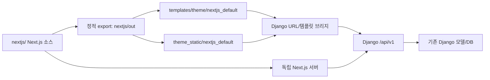

# Next.js 기본 테마 설계서

> 버전: 1.0.0 | 작성일: 2026-10-07 | 상태: 승인된 구현 기준
> 프로젝트 수준: Dynamic | 계획: `docs/01-plan/features/nextjs-default-theme.plan.md`

## 1. 목적과 설계 원칙

`nextjs/`의 Next.js 애플리케이션을 기본 화면 구현으로 사용하고, 빌드 결과를 Django 템플릿 경로 `gnu_jango/templates/theme/nextjs_default/`에 배포한다. 게시판, 회원, 쇼핑몰 데이터와 권한 검사는 Django API 및 기존 애플리케이션 서비스를 계속 사용한다.

참고 화면의 흰색 이중 헤더, 파란색 브랜드 강조, 게시판 미리보기와 오른쪽 정보 영역, 쇼핑 전용 화면 구성을 현재 Next.js 앱의 데이터 흐름에 맞게 옮긴다. PHP 테마 파일과 PHP 비즈니스 로직은 복사하지 않는다.

- 화면 계층은 `nextjs/`에서 유지하고 Django 빌드는 정적 HTML/RSC와 정적 자산을 제공한다.
- 계정·게시판·상품·주문 데이터 및 서버 권한 검사는 기존 Django API와 서비스를 사용한다.
- 새 데이터 모델, 마이그레이션, API 엔드포인트, 운영 DB 변경은 이 작업에 포함하지 않는다.
- `nextjs25` 설정값과 주소 이름은 호환 입력으로 받아들이고, 기본 테마 산출물은 `nextjs_default` 경로에서 제공한다.
- 관리자 작업은 Django `/admin/`에 남긴다. Next 화면에 별도 관리자 앱을 만들지 않는다.

## 2. UI 구조

### 2.1 공통 셸

`src/app/layout.tsx`가 공통 테마 토큰과 DaisyUI 플러그인을 로드하고 기존 Header, Footer, 인증·알림·모바일 내비게이션 제공자를 유지한다. 헤더는 브랜드/서비스 전환과 주요 메뉴가 있는 상단 영역, 계정·검색·장바구니 동작으로 구성한다. 좁은 화면에서는 현재 모바일 내비게이션과 헤더 액션을 사용한다.

기본 팔레트는 흰색과 옅은 청회색 표면, 진한 본문색, 접근 가능한 파란색 링크 및 브랜드 강조색으로 둔다. 기존 페이지별 기능 스타일은 공통 토큰을 통해 점진적으로 연결하고 전역 CSS 초기화나 기존 shadcn 컴포넌트 계약은 바꾸지 않는다.

### 2.2 커뮤니티 홈

홈은 최대 너비 컨테이너 안에 콘텐츠 열과 보조 정보 열을 둔다. 콘텐츠 열은 게시판별 최신글, 인기글, 갤러리/커뮤니티 강조 및 쇼핑 섹션을 제공한다. 보조 열은 로그인/회원 상태, 최근 댓글 또는 최신 활동, 투표·FAQ와 같은 바로가기를 표시한다. 데이터가 비어 있거나 관련 API가 오류를 반환하면 빈 상태 또는 해당 섹션의 오류 상태를 표시한다.

기존 `getHomeData`, `HomeCommunityHighlights`, `HomeShopSections`, `getBoards`, `getBoardPosts` 흐름을 재사용하고, 게시판 주소는 `boardPostHref`로 만든다. 기존 전체 게시판 개수 제한, 공개 글 필터, 데이터 캐시 주기를 유지한다.

### 2.3 쇼핑 화면

상품 목록과 상세, 카테고리, 장바구니, 주문, 비교 기능은 현재 `/shop` 라우트와 Django API를 유지한다. 쇼핑 경로에서는 커뮤니티와 구분되는 제목/검색/카테고리 영역을 제공하되 주문 단계와 결제는 기존 설정 및 서버 응답에 따른다. 작업 중 외부 PG 결제 요청은 발생시키지 않는다.

### 2.4 주요 화면 상태

| 화면 | 상태 | 표시 정책 |
|---|---|---|
| 홈 | 게시글 있음 | 게시판별 최신글과 인기글을 API 응답 순서/점수 규칙에 따라 렌더링 |
| 홈 | 빈 데이터 또는 API 실패 | 기존 데이터 접근 계층의 오류 처리와 테마의 빈 상태 UI 사용 |
| 게시판 | 비로그인/비회원 권한 | Django API 권한 응답에 따라 읽기, 쓰기, 비밀글 상태 표시 |
| 회원 | 인증 만료 | 기존 refresh 및 로그인 이동 흐름을 사용하고 개인 정보를 공유 캐시에 넣지 않음 |
| 쇼핑 | 품절/옵션/주문 오류 | 서버 API 결과를 그대로 반영하며 클라이언트에서 가격·주문 상태를 확정하지 않음 |

### 2.5 참고 화면과 현재 구현 비교

| 화면 | 참고 화면에서 확인한 특징 | 기존 `nextjs/` 구현 | 적용 결정 |
|---|---|---|---|
| 공통 헤더 | 서비스 전환 줄과 로고·주 메뉴 줄을 나눔 | 한 줄 헤더에 메뉴와 검색·계정 동작을 배치 | 서비스 선택 줄을 추가하고 기존 메뉴·검색·계정 동작 유지 |
| 커뮤니티 홈 | 파란 브랜드 강조, 게시판/갤러리 목록, 로그인 및 최신 활동 사이드 패널 | 초록색 강조의 인기글·최신글 패널 뒤에 게시판·쇼핑 섹션 배치 | 청색 토큰, 회원/포인트 패널, 바로가기와 최근 글을 오른쪽에 배치하고 게시판·쇼핑 데이터 서비스 재사용 |
| 쇼핑 | 커뮤니티와 구분되는 쇼핑 경로, 카테고리와 상품 탐색 | `/shop` 아래 상품·주문 화면과 API 서비스가 이미 존재 | 서비스 전환에서 쇼핑 상태를 구분하고 상품·옵션·주문 화면과 서버 검증을 유지 |
| 관리자 | 참고 PHP 사이트는 PHP 관리자 경로를 사용 | 현재 프로젝트에는 Django `/admin/`과 테마 관리자 경로가 공존 | 운영 관리는 Django `/admin/`으로 유지 |

API/권한 비교 결과는 다음과 같다. 참고 PHP API의 응답을 직접 복제하지 않고 현재 Django 계약을 사용한다.

| 사용자 흐름 | 대상 API/서비스 | 현재 테마에서 유지할 계약 |
|---|---|---|
| 메뉴·공개 설정 | `/api/v1/menus`, `/api/v1/settings` | API 결과를 메뉴 및 주소 재작성 설정에 사용 |
| 게시판·글 | `/api/v1/boards`, `/api/v1/boards/{bo_table}/posts` | 공개 목록은 현재 권한 필터를 따르고 상세·쓰기 동작은 게시판 API가 권한을 판정 |
| 인증·회원 | `/api/v1/auth/me`, `/api/v1/auth/login`, 기존 refresh/logout 서비스 | 인증 쿠키와 토큰 저장, 만료·갱신 처리 유지 |
| 쇼핑·주문 | 기존 `src/services/shop` 및 장바구니/주문 API 서비스 | 가격·재고·옵션·주문 검증은 Django 응답이 기준 |

## 3. 애플리케이션 구조와 데이터 흐름

| 영역 | 책임 |
|---|---|
| `nextjs/src/app`, `src/components` | 페이지, 레이아웃, 상태 표현, 접근 가능한 탐색 |
| `nextjs/src/services`, `src/lib` | Django API 호출, 인증 토큰/쿠키, URL 및 직렬화 계약 |
| `nextjs/scripts/sync-static-theme.mjs` | `out/` 파일을 새 Django 템플릿/정적 자산 폴더에 복사 |
| `nextjs/scripts/check-static-theme-sync.mjs` | 빌드와 배포 산출물 파일 집합 및 SHA-256 비교 |
| `gnu_jango/core/views.py` | HTML/RSC 응답, 런타임 설정 치환, 정적/public 자산 제공 |
| `gnu_jango/core/urls.py` | 루트, 게시판, 쇼핑, 메타데이터 경로 및 기존 URL 별칭 연결 |
| `gnu_jango/defaults.py`, `gnu_jango/api/v1_admin.py` | 기본 테마 식별자 설정; 기존 DB row는 자동 수정하지 않음 |

브라우저 요청은 Django 템플릿 산출물을 받으며, 정적 리소스는 `/_next/static/...` 및 허용된 public 자산 경로를 사용한다. 런타임 config 치환기는 현재 호스트·경로의 API 및 메타데이터 주소를 주입한다. 서버 실행 모드에서는 서버 전용 API URL을 사용하고 브라우저 번들에 비밀 설정을 노출하지 않는다.

## 4. 데이터 모델 및 API 계약

### 4.1 데이터 모델

신규 엔티티와 관계는 없다. 데이터 원본은 기존 `Board`, `Post`, `Member`, 상품·주문 모델과 현재 마이그레이션이다. 이 테마 변경은 스키마나 DB 값을 직접 갱신하지 않는다.

### 4.2 사용 API

기존 `/api/v1` API와 서비스 모듈을 그대로 사용한다. 주요 사용 데이터는 공개 설정/메뉴, 게시판 목록과 글·댓글, 현재 회원/인증, 상품·분류·장바구니·주문이다. 프런트엔드가 가격, 권한, 비밀글 가시성, 재고, 주문 상태를 최종 판정하지 않는다. 응답 계약 변경이 발견되면 별도 API 설계와 범위 승인 없이 새 서버 계약을 추가하지 않는다.

## 5. 테마 식별자와 경로 호환

- 신규 기본값은 `nextjs_default`다.
- 기존 저장값 `cf_theme=nextjs25`는 런타임에서 `nextjs_default` 산출물을 선택하도록 별칭 처리한다. 운영 DB를 일괄 수정하지 않는다.
- 공개 URL과 Django reverse name에 남은 `nextjs25` 경로/이름은 하위 호환을 위해 유지한다. `/nextjs/` 폴더와 산출물 디렉터리명은 별개다.
- 기존 `theme/nextjs25`와 `theme_static/nextjs25` 산출물이 이미 있는 환경에서 신규 빌드는 해당 폴더를 삭제하지 않는다.
- 기본 산출물은 `templates/theme/nextjs_default/`, 정적 청크는 `templates/theme_static/nextjs_default/_next/static/`에 둔다.
- 루트 페이지와 root/RSC/static/public fallback 모두 같은 새 테마 디렉터리를 선택해야 한다.
- 독립 Next.js 서버 모드는 `afterFiles` rewrite로 `/shop/list-{ca_id}`, `/shop/type-{type}`, `/shop/{itemId}`를 해당 정적 sentinel 화면으로 연결한다. rewrite가 전달하는 내부 query의 `__g5_ca_id`, `__g5_type`, `__g5_item_id`를 클라이언트에서 읽어 신규 카테고리·상품도 재빌드 없이 API로 조회한다. 실제 브라우저 주소는 짧은 경로를 유지한다.
- 정적 export는 짧은 상품·분류 주소의 서버 rewrite를 만들지 않는다. Django URL 브리지와 요청별 런타임 경로로 같은 화면을 제공한다.

## 6. 변경 대상과 순서

### 6.1 대상 파일

| 경로 | 변경 |
|---|---|
| `nextjs/src/app/globals.css` | 파란색/중립 표면 테마 토큰 및 DaisyUI 5 플러그인 등록 |
| `nextjs/src/app/layout.tsx`, `src/components/layout/Header.tsx` | 테마 공통 셸과 반응형 참고 헤더 스타일 연결 |
| `nextjs/src/app/page.tsx`, 관련 홈 컴포넌트 | 게시판 메인과 보조 정보 영역 조합, API 기반 빈 상태 |
| `nextjs/src/app/shop/**` | 기존 상품/주문 서비스는 보존하면서 참고 쇼핑 헤더·목록 레이아웃 적용 |
| `nextjs/next.config.ts` | 독립 서버에서 쇼핑 짧은 주소를 정적 sentinel 화면으로 rewrite |
| `nextjs/src/app/shop/categories/[ca_id]/ClientPage.tsx`, `products/page.tsx`, `products/[it_id]/ProductDetailClient.tsx` | rewrite query fallback으로 카테고리·상품 식별자를 읽고 기존 API 흐름 재사용 |
| `nextjs/package.json`, lock 파일 | DaisyUI 5 개발 의존성 등록 |
| `nextjs/scripts/sync-static-theme.mjs`, `check-static-theme-sync.mjs` | 배포 및 검증 대상 디렉터리를 `nextjs_default`로 전환 |
| `gnu_jango/defaults.py`, `gnu_jango/api/v1_admin.py` | 기본 식별자를 `nextjs_default`로 변경 |
| `gnu_jango/core/views.py`, `core/urls.py` | 새 산출물 경로 선택, 구 설정/URL 별칭 호환 유지 |
| `docs/02-design/features/nextjs-default-theme.design.md` | 설계 및 구현 계약 |

### 6.2 구현 순서

1. 테마 식별자와 Django 경로 선택 규칙을 정의하고 기존 경로 별칭을 유지한다.
2. export 동기화/검사 스크립트가 새 템플릿/자산 경로를 사용하도록 바꾼다.
3. DaisyUI 5와 공통 디자인 토큰을 추가하고 헤더·푸터·모바일 내비게이션의 기존 동작을 보존한다.
4. 홈과 쇼핑 화면을 API 응답에 연결된 참고 레이아웃으로 조정한다.
5. 빌드, 산출물 동기화, Django 시스템 체크, 서버 응답과 브라우저 주요 흐름을 확인한다.

## 7. 검증 기준

- `npm run typecheck`, `npm run lint`, `npm run build:theme`, `npm run check:theme-sync`가 통과한다.
- `manage.py check`가 통과하고 루트/게시판/쇼핑/로그인 경로 및 HTML/RSC 응답이 의도한 상태 코드를 반환한다.
- Django 정적 모드에서 Next dev 서버 없이 템플릿과 `_next/static` 자산을 제공한다.
- 신규 기본값과 기존 `cf_theme=nextjs25` 값이 모두 새 `nextjs_default` 테마를 선택한다. DB row는 변경되지 않는다.
- 390px, 768px, 1440px 화면에서 메뉴, 홈 두 열/단일 열 전환, 게시판 링크, 쇼핑 주요 동작을 확인한다.
- 비회원/회원 권한, 쓰기·주문 오류, 인증 만료 및 개인정보 캐시 경계는 기존 서버 계약을 따른다.
- 라이브 결제 요청 및 실제 운영 데이터 변경은 검증에 사용하지 않는다.

## 8. 보안 및 운영 고려사항

- API 권한과 게시글/회원/주문 접근 제어는 Django에 둔다.
- 인라인 런타임 JSON은 기존 escaping 함수를 사용하고 서버 전용 API 주소를 public config에 넣지 않는다.
- 인증/개인 페이지는 공유 캐시에 넣지 않고 기존 캐시 경계와 CSRF 처리 방식을 유지한다.
- 구매/결제는 기존 서버 검증과 PG 설정을 따르며 디자인 작업이 결제 동작을 새로 호출하지 않는다.
- 산출물 동기화 과정에서 사용자 업로드, 환경 파일, DB 파일을 복사하거나 삭제하지 않는다.

### 8.1 운영 설정의 CSP 보완 (2026-10-08)

분리 환경의 `DEBUG=False` 브라우저 검증에서 기존 정책이 Unfold의 Alpine 표현식과 Next의 인라인 bootstrap을 차단하는 것을 확인했다. 다음 계약으로 보완했다.

- Django 관리자 namespace와 별도 `admin-theme-settings` 뷰만 Alpine에 필요한 eval을 허용한다. 사용자 Next 관리자 shell은 이 허용 대상이 아니다.
- Next HTML 렌더러는 요청별 nonce를 export 스크립트에 붙이고 같은 값을 응답 CSP에 넣는다. 임의 인라인 스크립트와 eval은 운영 설정의 일반 화면에서 차단한다.
- 요청에서 가져온 런타임 JSON은 `<`, `>`, `&`를 이스케이프해 스크립트 경계를 벗어나지 않도록 한다.
- 기존 `.txt` RSC payload는 HTML nonce를 삽입하지 않고 기존 응답 유형과 URL 치환 계약을 유지한다.

검증 절차와 라이브러리 근거는 [배포 가이드](../../04-deploy/nextjs-default-theme.md)에 기록했다. 이 보완은 Django 서버 코드에 포함되며 테마 아카이브의 파일 구성은 바꾸지 않는다.
