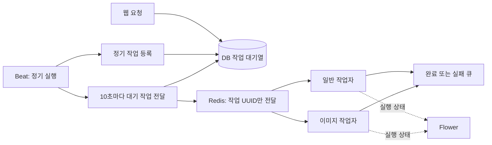

# Beat·작업자·Flower 운영 가이드

## 1. 무엇이 달라지나요?

`BACKGROUND_JOBS_ENABLED=True`일 때 다음 순서로 처리합니다.



웹은 작업을 DB에 저장하고 응답합니다. 발송·변환 완료까지 기다리지 않습니다. Redis에 전달하지 못해도 DB 기록은 남습니다. 대기 작업은 기본 10초 간격으로 전달되며, 큐가 밀려 있거나 재시도 대기 중이면 더 오래 걸립니다.

PostgreSQL의 새 outbox 테이블에는 RLS를 켜고 `PUBLIC`, Supabase `anon`·`authenticated` 역할의 테이블 권한을 제거합니다. 작업자는 테이블 소유자인 Django DB 계정으로 접근합니다. 별도의 제한된 DB 역할을 쓰는 환경에서는 해당 백엔드 역할에만 필요한 권한과 RLS 정책을 별도로 설정하세요.

이 기능은 **실제 작업자를 준비한 뒤 켜는 옵션**입니다. 기존 설치의 기본값은 `False`이고 Docker Compose의 기본값은 `True`입니다. 꺼진 상태에서는 기존 동기·cron 동작을 유지합니다. 기능을 켜면 개발 환경에서도 eager 실행을 끕니다.

## 2. 어떤 작업이 실행되나요?

| 작업 | 기본 간격 | 실행 큐 |
|---|---|---|
| 미결제 주문 만료 | 60초 | maintenance |
| 미인증 회원 만료 | 1시간 | maintenance |
| Toss 가상계좌 만료 | 60초 | maintenance |
| 관리자 개인정보 정리 | 24시간 | maintenance |
| 검색 클릭 기록 정리 | 24시간 | maintenance |
| 알림 발송 | 10초 | maintenance |
| 검색 색인 재시도 | 30초 | maintenance |
| 검색 상태 확인 | 10분 | maintenance |
| 주문 포인트 적립 | 5분 | maintenance |
| 작업 outbox 전달 | 10초 | maintenance |
| 완료 작업·실패 원문 보관 기간 정리 | 24시간 | maintenance |
| 메일·SMS | 요청 발생 시 DB 등록 | communications |
| 인증을 마친 서버 결제 웹훅 | 요청 발생 시 DB 등록 | payments |
| 이미지·썸네일 | 업로드·조회 시 DB 등록 | media |

주기는 `core/scheduled_jobs.py`의 `interval_seconds`에서 정의하고 `CELERY_BEAT_SCHEDULE`에서 사용합니다. 24시간 간격 작업은 특정 자정이 아니라 스케줄러의 실행 이력에 따른 간격입니다. 사이트 시간대는 `TIME_ZONE`을 따릅니다.

Beat를 두 개 실행하면 중복 전달이 발생할 수 있으므로 **한 사이트에 하나만** 실행하세요. DB의 활성 작업 키가 중복 실행을 추가로 막습니다. 기존 system cron, Vercel Cron 또는 외부 HTTP 스케줄은 전환 후 끕니다. 새 모드의 `/api/internal/cron`은 실제 명령을 실행하지 않고 같은 대기열에 작업만 등록하는 호환 경로입니다. `dry_run` 조회는 기존 점검을 유지합니다.

## 3. VPS에서 시작하기

먼저 DB와 미디어를 백업하고 `deploy/env/vps.env.example`을 참고하여 저장소 밖 설정 파일을 준비하세요. 다음은 **VPS 자체 PostgreSQL과 Redis를 사용하는 Docker Compose 구성**입니다. 기존 Supabase 프로젝트에 연결하는 절차로 사용하면 안 됩니다.

```dotenv
BACKGROUND_JOBS_ENABLED=True
CELERY_TASK_ALWAYS_EAGER=False
```

이 값을 모든 웹·작업자·Beat에 동일하게 적용합니다. 메일 전송은 기존 `EMAIL_BACKEND`, `EMAIL_HOST`, `EMAIL_PORT`, 인증·TLS 설정을 그대로 사용합니다. `MAILERS.default`는 DB 접수용, `MAILERS.delivery`는 작업자의 실제 발송용으로 구성됩니다.

```bash
docker compose up -d --build web worker media-worker beat
```

웹 컨테이너가 `migrate`로 새 `core.0015_backgroundjob` 테이블을 만든 뒤 준비 상태가 되면 작업자와 Beat가 시작합니다. worker는 일반 작업, media-worker는 이미지 작업을 처리합니다. 미디어 볼륨과 DB를 공유합니다. Redis AOF와 Beat 실행 이력도 전용 볼륨에 보관합니다.

기존 컨테이너에 마이그레이션을 따로 적용하는 배포라면 먼저 다음 명령을 실행한 후 웹·작업자 설정을 전환하세요.

```bash
python manage.py migrate
python manage.py check
```

수동 프로세스 구성에서는 다음 명령을 각각 별도 서비스로 실행합니다. Linux/컨테이너의 prefork 작업자를 기준으로 합니다. Windows 기본 프로세스보다 Docker 또는 WSL을 사용하세요.

```bash
celery -A example worker -l INFO -Q celery,maintenance,communications,payments --concurrency=2
celery -A example worker -l INFO -Q media --concurrency=1 --hostname=media@%h
celery -A example beat -l INFO --schedule=/writable/private/path/celerybeat-schedule
```

이미 별도의 알림 watch 프로세스(`process_notifications --watch`)를 사용하고 있다면 Beat의 알림 처리와 운영 주체를 하나로 정하세요. Beat를 사용하는 기본 구성에서는 별도 watch 프로세스가 필요하지 않습니다.

## 4. 실패 큐와 재시도

작업은 `pending → running → succeeded`로 이동합니다. 일시적 실패는 15초부터 시작하는 지수 백오프와 0~10초 jitter를 거쳐 다시 대기합니다. 기본 최대 시도 횟수는 최초 실행을 포함해 5회입니다. 재시도 간격 상한은 30분입니다.

작업 실행의 soft timeout은 270초, hard timeout은 300초, DB 작업 임대는 360초입니다. 전달 후 실행되지 않은 작업 UUID는 60초 뒤 다시 전달할 수 있습니다. 중복 메시지는 DB에서 실행자를 하나만 선택합니다. 임대 만료 작업은 다시 대기시키거나 최종 실패로 기록합니다.

**메일·SMS는 특별히 주의합니다.** SMTP 4xx 거부나 SMS 연결 실패처럼 미전송이 확인된 경우에만 자동 재시도합니다. 연결 중단·작업자 강제 종료처럼 제공자의 접수 여부가 불분명하면 `delivery_uncertain`으로 최종 실패 처리합니다. 정확히 한 번 발송을 보장한다고 간주하지 마세요.

관리자 **운영 → 백그라운드 작업 / 실패 큐** 또는 `/admin/core/backgroundjob/`에서 상태·시도 횟수·실패 코드를 확인합니다. 최고 관리자만 볼 수 있으며 수신자, 메일 본문, 원본 이미지, 결제 비밀값은 표시하지 않습니다.

```bash
# 상태별 건수 조회: 실행·전송 없음
python manage.py process_background_jobs

# 특정 실패 작업 조회: 실행 없음
python manage.py replay_background_jobs --id <작업-UUID>

# 일반 실패 작업 재처리 예약
python manage.py replay_background_jobs --id <작업-UUID> --apply
```

발송 결과 불명 작업은 먼저 SMTP/iCode 제공자 기록에서 실제 발송 여부를 확인하세요. 중복 발송 가능성을 확인한 뒤에만 다음 옵션을 추가합니다. 관리자 화면의 일반 재처리 동작은 이런 작업을 제외합니다.

```bash
python manage.py replay_background_jobs --id <작업-UUID> --apply --allow-uncertain
```

원문이 보관 기간 만료로 지워졌거나, 삭제한 파일·유효 기간이 지난 작업은 재처리할 수 없습니다. 메일·SMS 대기 작업은 하루, 이미지 원본은 7일이 지나면 실행 시 만료 처리합니다. 결제 실패 건은 PG와 주문 기록을 확인한 뒤 재처리하세요.

성공한 작업은 원문을 즉시 지우고 7일 뒤 기록을 삭제합니다. 최종 실패 작업은 7일 뒤 원문을 지우며, 상태·실패 코드 등 메타데이터는 30일 뒤 삭제합니다. 이 정리는 Beat와 작업자가 실행 중이어야 동작합니다.

## 5. Flower

Flower는 웹 서버에 기본 설치하지 않습니다. 모니터링용 컨테이너만 `requirements-monitoring.txt`를 설치합니다. 저장소 밖 환경 설정에 별도의 인증 정보를 넣은 뒤 실행하세요. 기본 비밀번호는 제공하지 않습니다.

```dotenv
FLOWER_BASIC_AUTH=operator:<직접-정한-강한-비밀번호>
```

```bash
docker compose --profile monitoring up -d --build flower
```

접속 주소는 `http://127.0.0.1:5555/`입니다. 원격 서버에서는 SSH 포트 포워딩으로 접속하세요. Flower는 읽기 전용이며 인증 없이 시작되지 않습니다. 포트는 호스트 loopback에만 연결합니다. `/metrics` 등 일부 경로는 Flower 인증의 예외이므로 포트를 인터넷에 직접 공개하지 마세요.

Flower는 작업자와 Celery 메시지의 실행 상태를 보여줍니다. **아직 Redis로 전달되지 않은 DB 대기 작업과 최종 실패 원문 보관 상태는 Django 관리자에서 확인**하세요. Flower에서 성공으로 보이는 중복 전달 건도 실제 작업 상태는 DB 기록을 기준으로 판단합니다.

## 6. Vercel·PythonAnywhere

상주 작업자와 Beat는 웹 프로세스와 별도로 준비해야 합니다. 기존 공개 데모에는 이 작업만으로 외부 작업자가 생성되거나 설정이 자동 적용되지 않습니다.

Vercel 웹과 외부 작업자가 같은 사이트를 처리하려면 **동일한 DB, SECRET_KEY, 메일·SMS·PG 설정, S3 버킷**을 사용해야 합니다. 작업자는 웹의 `/tmp` 파일에 접근할 수 없으므로 공유 객체 스토리지가 필요합니다. 기존 데모와 핸드북의 DB·브로커·버킷은 섞지 마세요. 각각 별도 Redis DB 또는 broker namespace와 별도 Beat를 사용합니다.

새 모드는 `SECRET_KEY` 해시로 Redis 브로커·결과 키에 사이트별 접두사를 추가합니다. 따라서 같은 사이트의 웹·작업자·Beat·Flower는 같은 키를 사용해야 합니다. AMQP를 선택하는 경우에는 사이트마다 별도 vhost를 사용하세요.

외부 작업자를 준비하지 않은 무료 PythonAnywhere 데모에서는 기존 모드를 유지할 수 있습니다. DB 대기열을 운영 명령으로 처리해야 하는 경우 다음 명령이 있지만 Celery prefork의 hard timeout이나 Flower 상태 추적을 대신하지는 않습니다.

```bash
# 운영자 명령에서만 사용: 메일/SMS 등 실제 외부 동작을 실행할 수 있음
python manage.py process_background_jobs --apply --limit 20

# 실행하지 않고 UUID를 Celery로 전달
python manage.py process_background_jobs --dispatch --limit 100
```

웹 사용자 요청에서 위 실행 명령을 호출하지 마세요. 외부 작업자가 없는 상태에서 새 모드를 켜면 가입 인증 메일·문자·이미지 처리가 계속 대기합니다.

## 7. 이미지와 결제의 동작 차이

- 새 모드의 JPEG/PNG/MPO 업로드는 작은 안전한 임시 이미지를 먼저 저장하고 원본은 비공개 DB 작업에만 둡니다. 작업자가 검증·메타데이터 제거 후 최종 파일을 저장합니다. 처리 전에는 임시 이미지가 보일 수 있으며, 완료 후 새로고침하면 실제 이미지를 볼 수 있습니다.
- 기존 보존 정책에 따라 애니메이션·WebP 등 다시 인코딩하지 않는 형식은 그대로 저장합니다. 콘텐츠 유형·이미지 헤더·크기 검증은 요청에 남아 있습니다.
- 썸네일이 없으면 대기열에 생성 작업을 넣고 우선 원본으로 이동합니다. 다음 조회부터 생성된 썸네일을 제공합니다. 준비 중인 새 업로드는 안전한 임시 이미지만 공개됩니다.
- 서버 결제 웹훅은 인증·서명 검증과 DB 접수 후 200으로 응답합니다. `queued`는 접수 완료이며 결제 반영 완료가 아닙니다. Toss 입금 상태는 작업자가 PG에서 다시 조회하여 확인합니다. 고객의 결제 승인 요청·브라우저 반환은 기존 흐름을 유지합니다.

## 8. 전환·중단 시 확인할 것

1. DB 백업 후 마이그레이션을 적용합니다.
2. 웹과 모든 작업자에 같은 새 설정을 배포합니다.
3. 작업자 두 종류와 Beat 하나를 시작합니다.
4. 기존 cron 실행과 별도 알림 watch 프로세스의 중복 운영을 정리합니다.
5. 관리자에서 pending이 줄고 성공/실패가 기록되는지 확인합니다. Flower에서 두 작업자가 표시되는지 확인합니다.
6. 기능을 끌 때는 새 요청 유입을 멈추고 남은 대기 작업을 먼저 처리하세요. 원본을 비공개로 둔 이미지 작업이 남은 채로 끄면 임시 이미지가 유지됩니다. 대기열을 비우기 위해 테이블이나 Redis 데이터를 임의로 삭제하지 마세요.

## 참고

- [Celery 정기 작업: 단일 Beat와 스케줄 설정](https://docs.celeryq.dev/en/stable/userguide/periodic-tasks.html)
- [Celery 작업: 재시도·시간 제한·멱등성](https://docs.celeryq.dev/en/stable/userguide/tasks.html)
- [Flower 인증](https://flower.readthedocs.io/en/latest/auth.html)
- [Flower 설정](https://flower.readthedocs.io/en/latest/config.html)
